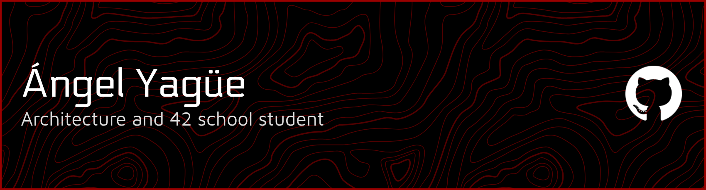

## About me

I am an architecture student who believes software will reshape the way architecture is made. Understanding both tools will be key to success.

## Student curriculum

- Architecture student at UAH
- Software student at 42 Madrid

## Main tech

